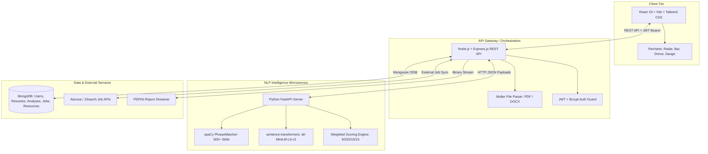

# SkillGap Analyzer 🚀
### AI-Powered Resume & Job Market Benchmarking Platform

**SkillGap Analyzer** is a production-grade full-stack platform designed to help technical job seekers audit their resumes against live industry demand, quantify their readiness score out of 100, identify critical skill gaps, follow an accelerated 4-week learning roadmap, and match with currently hiring companies.

---

## Architecture Diagram



---

## Tech Stack

| Layer | Technologies |
| :--- | :--- |
| **Frontend** | React 18, Vite, Tailwind CSS, Recharts, Axios, React Router v6, Lucide Icons |
| **Backend REST API** | Node.js, Express.js, Mongoose, Joi, Multer, PDFKit, JWT, BcryptJS |
| **NLP Microservice** | Python 3.10+, FastAPI, spaCy (`en_core_web_sm`), `sentence-transformers`, `scikit-learn` |
| **Database** | MongoDB (Local or MongoDB Atlas) |
| **External APIs** | Adzuna API, RapidAPI JSearch, with fallback to local MongoDB dataset |

---

## 4-Factor Weighted Scoring Formula

Every resume analysis is evaluated out of **100 points** using the following weighted criteria:

$$\text{Overall Score} = (0.50 \times S_{\text{skills}}) + (0.20 \times S_{\text{projects}}) + (0.15 \times S_{\text{experience}}) + (0.15 \times S_{\text{quality}})$$

1. **Skill Match (50% Weight)**: Verified skills on the resume evaluated against required skills, weighted by each skill's frequency across active job postings:
   $$S_{\text{skills}} = \frac{\sum_{i \in \text{Matched}} \text{Demand}_i}{\sum_{j \in \text{Target}} \text{Demand}_j} \times 100$$
2. **Project Relevance (20% Weight)**: Cosine similarity between candidate project descriptions and the target role using 384-dimensional dense vector embeddings generated by `all-MiniLM-L6-v2`.
3. **Experience Relevance (15% Weight)**: Semantic alignment between work history/internships and industry expectations for that role.
4. **Resume Quality & Keywords (15% Weight)**: Structural completeness (presence of skills, experience, education, projects) combined with quantified metrics regex analysis (e.g., `increased throughput by 35%`, `managed $100k budget`).

### Readiness Categorization
- **Job-Ready**: Score $\ge 75$ — Strong technical and project alignment with modern openings.
- **Intermediate**: Score $50 - 74$ — Solid foundation with targeted gaps to close.
- **Beginner**: Score $< 50$ — Fundamental concepts required before interview stage.

---

## REST API Documentation

### 1. Authentication Endpoints (`/api/v1/auth`)

#### `POST /api/v1/auth/register`
Creates a new user profile and returns a signed JWT.
- **Request Body:**
  ```json
  {
    "name": "Jane Developer",
    "email": "jane@example.com",
    "password": "Password123",
    "targetRole": "Full Stack Engineer"
  }
  ```
- **Response (201 Created):**
  ```json
  {
    "success": true,
    "message": "User registered successfully",
    "data": {
      "user": { "id": "6722...abc", "name": "Jane Developer", "email": "jane@example.com" },
      "token": "eyJhbGciOiJIUzI1NiIsIn..."
    }
  }
  ```

#### `POST /api/v1/auth/login`
Authenticates user credentials and returns a JWT.
- **Request Body:** `{ "email": "jane@example.com", "password": "Password123" }`

#### `GET /api/v1/auth/me`
Returns the currently authenticated user session.
- **Headers:** `Authorization: Bearer <token>`

---

### 2. Resume Management (`/api/v1/resumes`)

#### `POST /api/v1/resumes/upload`
Uploads and parses a PDF or DOCX resume (max 5 MB).
- **Headers:** `Authorization: Bearer <token>`, `Content-Type: multipart/form-data`
- **Body:** `resume: <File>`
- **Response (201 Created):**
  ```json
  {
    "success": true,
    "message": "Resume uploaded and parsed successfully",
    "data": {
      "resume": {
        "id": "6722...def",
        "originalFileName": "Jane_Resume.pdf",
        "fileType": "pdf",
        "sections": { "skills": [...], "experience": [...], "projects": [...] },
        "extractedSkills": [{ "name": "React", "category": "Web Frameworks" }]
      }
    }
  }
  ```

#### `GET /api/v1/resumes`
Retrieves all resumes uploaded by the logged-in user.

---

### 3. Skill Gap Analysis (`/api/v1/analyses`)

#### `POST /api/v1/analyses`
Executes full gap analysis pipeline.
- **Request Body:**
  ```json
  {
    "resumeId": "6722...def",
    "jobTitle": "Full Stack Developer",
    "jobDescription": "Optional: paste custom JD to benchmark against specific posting"
  }
  ```
- **Response (201 Created):** Returns overall score, scores breakdown, matched & missing skills, radar metrics, 4-week roadmap, and matching live jobs.

#### `GET /api/v1/analyses`
Retrieves past analysis history for progression tracking.

#### `GET /api/v1/analyses/:id`
Retrieves a single complete analysis report.

#### `GET /api/v1/analyses/:id/report`
Streams a formatted analysis report as a downloadable PDF.

---

### 4. Job Postings & Suggestions (`/api/v1/jobs`)

#### `GET /api/v1/jobs`
Query parameters: `title`, `location`, `isRemote` (`true`/`false`), `experienceLevel`.

#### `GET /api/v1/jobs/suggestions`
Query parameter: `q` (e.g., `?q=devops`). Returns autocomplete suggestions.

---

## Local Setup & Quickstart

### Prerequisites
- Node.js 18+ and npm
- Python 3.10+ (with `venv`)
- MongoDB (Running locally on `mongodb://localhost:27017` or Atlas cluster URI)

### 1. Start Python NLP Microservice
```powershell
cd nlp-service
python -m venv venv
.\venv\Scripts\Activate.ps1       # On Linux/macOS: source venv/bin/activate
pip install -r requirements.txt
python -m spacy download en_core_web_sm
cp .env.example .env
uvicorn app.main:app --host 0.0.0.0 --port 8000 --reload
```

### 2. Start Node.js Backend & Seed Database
```powershell
cd backend
npm install
cp .env.example .env
npm run seed                      # Seeds 37+ skill courses and 12+ verified job postings
npm run dev                       # Starts Express server on http://localhost:5000
```

### 3. Start React Frontend
```powershell
cd frontend
npm install
cp .env.example .env
npm run dev                       # Starts Vite server on http://localhost:5173
```

---

## Screenshots & UI Walkthrough

### 1. Landing Page (`/`)
Clean, modern landing screen detailing the value proposition, 3-step audit process, and quick links to live market openings.

```text
+-------------------------------------------------------------------------+
| [SkillGap.ai]          Analyze   Hiring Companies   History   [Sign In] |
+-------------------------------------------------------------------------+
|                                                                         |
|      Audit your resume against the LIVE JOB MARKET.                     |
|      Uncover your skill gaps, 4-factor score, and 30-day roadmap.        |
|                                                                         |
|             [ Analyze Your Resume Now -> ]   [ Browse Jobs ]            |
|                                                                         |
|  [✓ 500+ Skills Dictionary]  [✓ Transformer Embeddings]  [✓ Free PDF]   |
+-------------------------------------------------------------------------+
```

### 2. Upload & Analyze (`/analyze`)
Drag-and-drop resume upload zone (accepts `.pdf` / `.docx` $\le 5$ MB), debounced job title selector with autocomplete suggestions, and optional custom job description paste field.

```text
+-------------------------------------------------------------------------+
| Step 1: Upload Resume (PDF / DOCX Max 5MB)                              |
| +---------------------------------------------------------------------+ |
| |          [ ☁ ] Click to upload or drag & drop your resume           | |
| +---------------------------------------------------------------------+ |
|                                                                         |
| Step 2: Target Role & Context                                           |
| Target Job Title: [ Full Stack Developer                          🔍 ]  |
| Target Job Description: [ Optional: Paste specific job posting...   ]  |
|                                                                         |
|                                           [ Launch Gap Analysis ✨ -> ] |
+-------------------------------------------------------------------------+
```

### 3. Results Dashboard (`/results/:id`)
Displays overall match gauge out of 100, 4 weighted score breakdown cards, interactive Recharts visualizations (Radar chart, Bar chart of missing skills by market demand %, Donut coverage chart), and an interactive 4-week learning roadmap.

```text
+-------------------------------------------------------------------------+
| Target Role: Full Stack Developer                     [ Download PDF ⬇ ]|
+-------------------------------------------------------------------------+
| [ 82 / 100 ]            | Skill Match (50%): 84%   Projects (20%): 80%  |
| [ Job-Ready ]           | Experience (15%): 78%    Quality (15%):  85%  |
+-------------------------+-----------------------------------------------+
| Donut Chart: Coverage   | Missing Skills Bar:      | Competency Radar:  |
| 14 Matched / 4 Missing  | - Docker (54% Demand)    | Languages: 90%     |
|                         | - AWS (51% Demand)       | Frameworks: 85%    |
+-------------------------+--------------------------+--------------------+
| 4-Week Accelerated Upskilling Roadmap:                                  |
| • Week 1: Core Syntax & State Management (Redux, TypeScript)            |
| • Week 2: Microservices & Docker Containerization                       |
| • Week 3: Cloud Deployment (AWS S3 & EC2)                               |
| • Week 4: System Design & Production Capstone Project                   |
+-------------------------------------------------------------------------+
```

---

## Edge Case Handling

- **Scanned / Empty PDFs**: `pdf-parse` checks character count. If a scanned document lacking selectable text is provided, a descriptive HTTP 422 error is returned asking the user for a text-based document.
- **External API Failures**: If Adzuna or RapidAPI credentials are missing, expired, or rate-limited, the system automatically and transparently falls back to the local MongoDB `JobPosting` collection.
- **Zero Skills Detected**: If a resume contains no matching skills, a graceful fallback neutral score is returned with foundational course recommendations.
- **File System Hygiene**: Temporary files uploaded to `uploads/` are automatically unlinked if parsing, validation, or database storage encounters an exception.

---

## License
MIT License. Built with Google Antigravity AI Engine.

